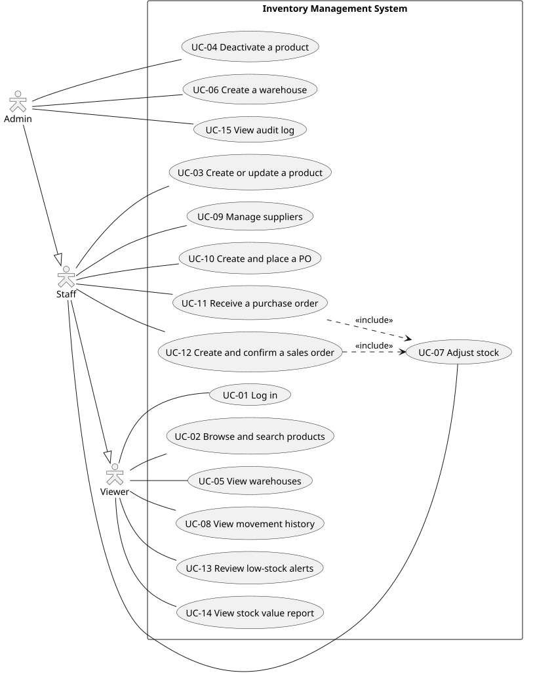

# Inventory Management — Architecture (4+1 Views)

## 0. Overview

### 0.1 Architectural goals

| Goal | How the architecture addresses it |
|---|---|
| Stock is **always correct**, never negative | `CHECK (quantity >= 0)` in the DB + optimistic locking + append-only movements |
| Every change is **traceable** | Immutable `stock_movement` + `audit_log` written by the service layer |
| **No duplicate writes** when a client retries | `Idempotency-Key` + unique index + handling in the service layer |
| Easy to demo, easy to deploy | One single artifact (modular monolith) + Docker Compose |
| Easy to test | Clear layering, Testcontainers for data and integration tests |

### 0.2 Constraints & assumptions

- **One** Spring Boot application (modular monolith). No Kafka, no Redis, no microservices.
- Frontend is **out of scope** — Swagger UI / Postman is the demo interface.
- End users: a single small shop. Target scale: **~200 concurrent users**, data volume in the low hundreds of thousands of `stock_movement` rows.
- Money: `BigDecimal(2)`. Time: `Instant` in UTC. Quantities: whole numbers.
- One PostgreSQL database, schema owned by Flyway, Hibernate set to `validate` only.

---

## 1. +1 — Scenario view (Use cases)

### 1.1 Actors

| Actor | Permissions | Notes |
|---|---|---|
| `VIEWER` | Read-only: products, stock, history, alerts, reports | Base role; accounting / management |
| `STAFF` | `VIEWER` + product writes, stock adjustments, purchase and sales orders | Primary user |
| `ADMIN` | `STAFF` + product deactivation, warehouse creation, audit log | Few users |

### 1.2 Overall use cases




*Source: [`diagrams/01-use-case.puml`](./diagrams/01-use-case.puml)*

### 1.3 Architectural scenarios (quality attributes)

These scenarios are used to **validate** the architecture; each one must map to at least one component in the Logical or Process view.

| ID | Scenario | Attribute | Acceptance criteria |
|---|---|---|---|
| S1 | 50 staff sell the **last unit** of a product at the same time | Correctness | Exactly **1** SO succeeds; the other 49 get `409 Conflict`; stock never goes negative |
| S2 | A client retries with the **same `Idempotency-Key`** 3 times after a timeout | Reliability | Exactly **1** SO is created; the next 2 calls return the **same** result and do not take stock again |
| S3 | Staff clicks "Receive" on a PO **twice in a row** | Correctness | Stock increases **once**; the PO becomes `RECEIVED` exactly once |
| S4 | 200 users read `/products` + `/stock` concurrently | Performance | p95 < 300 ms, error rate < 1 % |
| S5 | Review "who changed what" on a product from 6 months ago | Auditability | Actor, timestamp and old/new values are retrievable from `audit_log` |
| S6 | Deploy a new version to the demo environment | Operability | `docker compose up` works on a clean machine, no manual DB fixes |

---

## 2. Logical view

The system is a single deployable application split into seven feature slices, plus two pieces of shared infrastructure. There is no diagram here on purpose: the slice boundaries are described in prose below and the exact package tree is in section 4.1.2, so a picture would only repeat the same information.

### 2.1 The slices

| Slice | Owns | Talks to |
|---|---|---|
| `product` | products, categories | `audit` |
| `warehouse` | warehouses | `audit` |
| `supplier` | suppliers | `audit` |
| `stock` | stock levels, movement history | `audit` |
| `order` | purchase orders, sales orders, idempotency keys | `stock` (to move stock), `audit` |
| `report` | read-only projections, CSV export | `stock` and `product` (to read) |
| `audit` | the append-only audit trail | nobody |

Every slice has the same internal shape: a **controller** that handles HTTP, a **service** that holds the business rules and the transaction boundary, a **mapper** that converts between JPA entities and the API records in `common/dto`, and a `persistence/` package that holds the entities, enums and Spring Data repositories. That shape is identical in all seven slices, which is why it is described once here and not repeated in the table.

### 2.2 How the slices relate

**`security` sits in front of everything, and nothing depends on it.** `JwtAuthenticationFilter` authenticates the request once, then the controller runs. No service or repository ever imports a security type — authentication is a concern of the web layer only.

**`stock` is the single source of truth for quantities.** It is the only slice that writes `stock_item` and `stock_movement`. When a purchase order is received or a sales order is confirmed, `order` does not touch those tables; it calls `StockService`, which applies the change, appends a movement row, and lets the database constraint reject anything that would go negative. This one direction — `order → stock`, never the reverse — is what makes the stock rule impossible to bypass.

**`report` is read-only and reads through services.** It never writes and never joins across slice tables in SQL; it asks `StockService` and `ProductService` for what it needs. That keeps the reporting queries from silently depending on the internal table layout of other slices.

**`audit` is called, not calling.** Services call `AuditService` when something worth tracing happens. `AuditService` never calls back into a slice, so there is no cycle and no risk of an audit entry triggering more business logic.

**There are no cycles.** The dependency graph is acyclic: `security → controllers`, then `order → stock`, `report → stock/product`, and everything → `audit`. A slice may call another slice's *service*, never its repository or entity — importing a foreign `persistence/` type is a compile-time decision that this document forbids (see 4.3).

### 2.3 Shared infrastructure

Two packages are not slices, because they hold no feature logic:

- **`common`** — the API records (`dto/`), the exception hierarchy and `@RestControllerAdvice` (`error/`), paging helpers (`paging/`), and small value types such as `BaseAuditableEntity` and `Money`/`Quantity` (`primitives/`). Every slice may depend on it; it depends on no slice.
- **`security`** — the filter chain, the JWT service, the URL-to-role matrix, and its own `persistence/` package holding `app_user`, `role` and `refresh_token`. It looks like a slice (controller-free, but with entities and repositories) because it is the only owner of the identity tables, yet **no other package may import it**: it depends on `common` only, and the dependency arrow never points back.

Everything ultimately persists to a single PostgreSQL 16 database whose schema is owned by Flyway; no slice has its own database.

---

## 4. Development view — Code organization & process

This section describes how the code is structured and the conventions we follow to keep the project maintainable and scalable.

### 4.1 Build structure

#### 4.1.1 Repository layout

The project is designed to be easy to build and deploy. We use the Maven wrapper (`mvnw`) to ensure consistent builds across different environments without requiring a local Maven installation. For deployment, a multi-stage `Dockerfile` is provided to package the application into a lightweight JRE 17 runtime.

Configuration is managed through Spring profiles. Local development uses `application-dev.yml` (connected to a Docker Compose setup), while `application-test.yml` is optimized for integration tests using Testcontainers. Sensitive information like database credentials and JWT secrets are kept in `.env` files, which are never committed to version control.

```text
inventory-management/
├── pom.xml                       # Spring Boot 4.1.2 parent, Java 17, deps pinned by the BOM
├── mvnw, mvnw.cmd, .mvn/wrapper/ # Maven wrapper — the CI image needs no local Maven
├── Dockerfile                    # multi-stage: mvnw -DskipTests package → JRE 17 runtime
├── docker-compose.yml            # app + postgres 16 + named volume
├── .env.example                  # DB URL/user/password, JWT_SECRET (copied to .env, never committed)
├── .gitignore                    # target/, .env, IDE folders
├── README.md                     # demo URL, benchmark numbers, run instructions
├── docs/
│   ├── implementation-plan.md
│   ├── architecture.md           # this document
│   └── diagrams/
│       ├── 01-use-case.puml
│       └── out/*.svg             # committed render, referenced by the markdown
└── src/
    ├── main/
    │   ├── java/com/codefultm/inventory_management/   # see 4.1.2
    │   └── resources/
    │       ├── application.yml       # shared: datasource keys, JPA validate, OpenAPI
    │       ├── application-dev.yml   # local PostgreSQL from docker compose, SQL logging on
    │       ├── application-test.yml  # Testcontainers datasource, Flyway on
    │       └── db/migration/         # V1__init.sql, V2__*.sql …  ← only source of schema
    └── test/
        └── java/com/codefultm/inventory_management/
            ├── …mirrors main 1:1 (product/, stock/, order/, …)
            └── testsupport/          # AbstractIntegrationTest, PostgresContainer, fixture builders
```

#### 4.1.2 Java package structure — Vertical Slices

We follow a **vertical slice architecture** rather than a traditional layered one. Instead of grouping all controllers in one package and all services in another, each feature (e.g., `product`, `stock`, `order`) is a self-contained unit.

Each slice contains its own:
- **Controller**: Handles HTTP requests.
- **Service**: Contains the core business logic.
- **Mapper**: Converts between entities and DTOs.
- **`persistence/`**: The whole data layer for the slice — JPA entities, enums, and the Spring Data repositories that query them.

This approach minimizes the impact of changes; a single feature PR typically only touches files within one directory.

```text
com.codefultm.inventory_management/
├── InventoryManagementApplication.java   # @SpringBootApplication only, no logic
│
├── common/                               # shared by every slice
│   ├── dto/                              # one file per feature: ProductDtos, StockDtos, OrderDtos …
│   ├── error/                            # ApiException hierarchy + GlobalExceptionHandler (@RestControllerAdvice)
│   ├── paging/                           # PageResponse<T>, PageRequestFactory
│   └── primitives/                       # BaseAuditableEntity, Money/Quantity helpers
│
├── config/                               # OpenAPI, Jackson (Instant), Clock bean, CORS
│
├── security/
│   ├── SecurityConfig.java               # filter chain, URL → role matrix
│   ├── JwtAuthenticationFilter.java      # once-per-request token parsing
│   ├── JwtService.java                   # issue / validate / refresh
│   ├── AppUserDetailsService.java        # loads AppUser, maps roles to authorities
│   └── persistence/
│       ├── AppUser · Role · RefreshToken # credentials, role enum, refresh-token rotation
│       └── AppUserRepository · RefreshTokenRepository
│
├── product/
│   ├── ProductController.java
│   ├── ProductService.java
│   ├── ProductMapper.java
│   └── persistence/
│       ├── Product · Category            # JPA entities / enums
│       └── ProductRepository.java        # Spring Data interface
│
├── warehouse/
│   ├── WarehouseController · WarehouseService · WarehouseMapper
│   └── persistence/  Warehouse · WarehouseRepository
│
├── supplier/
│   ├── SupplierController · SupplierService · SupplierMapper
│   └── persistence/  Supplier · SupplierRepository
│
├── stock/
│   ├── StockController.java              # GET /stock, POST /stock/adjust, GET /stock/movements
│   ├── StockService.java                 # the only writer of stock_item + stock_movement
│   ├── AdjustmentCommand.java            # validated intent object (delta, reason, reference)
│   ├── StockMapper.java                  # entity ↔ StockDtos records
│   └── persistence/
│       ├── StockItem · StockMovement · MovementType
│       └── StockItemRepository · StockMovementRepository
│
├── order/
│   ├── PurchaseOrderController · PurchaseOrderService
│   ├── SalesOrderController   · SalesOrderService
│   ├── PurchaseOrderStateMachine · SalesOrderStateMachine
│   ├── IdempotencyService                # order-level idempotency guard
│   ├── OrderMapper
│   └── persistence/
│       ├── PurchaseOrder · PurchaseOrderLine · SalesOrder · SalesOrderLine · OrderStatus
│       └── PurchaseOrderRepository · SalesOrderRepository · IdempotencyKeyRepository
│
├── report/
│   ├── ReportController.java · ReportQueryService.java  # read-only projections, CSV export
│   └── LowStockQuery · StockValueQuery
│
└── audit/
    ├── AuditService.java                 # called by services, writes audit_log
    └── persistence/  AuditLog · AuditLogRepository
```

### 4.2 Why Vertical Slices?

The main benefit of this structure is **locality of change**. When you add or modify a feature, you don't have to jump between multiple layers of the project. Everything related to that feature is right there.

The `mapper` sub-package is also kept within the slice. For example, `StockMapper` lives in the `stock/` package because it's the bridge between the `stock/persistence` entities and the `common/dto` records. This keeps the domain entities isolated from the API contract.

Repositories live inside `persistence/` as well, right next to the entities they persist. The slice root then holds only the code that carries behavior (controller, service, mapper), while `persistence/` is the single place to look for everything that touches the database.

### 4.3 Development Conventions

To maintain consistency, we follow these rules:

| Topic | Convention |
|---|---|
| **DTOs** | Every `record` used at the API boundary lives in `common/dto`. We use one file per feature (e.g., `StockDtos.java`) containing nested `record`s. Requests end with `Request`, responses with `Response`. |
| **Naming** | Use standard suffixes: `XxxController`, `XxxService`, `XxxRepository`, `XxxStateMachine`. |
| **Transactions** | Apply `@Transactional` at the service level only. Mark read-only queries with `readOnly = true`. |
| **Cross-slice calls** | A slice may only call another slice's `Service`. Importing a foreign `persistence/` type (repository or entity) is not allowed. |
| **Validation** | Use Bean Validation on DTOs for input format, and implement business rules within the service layer. |
| **Migrations** | Never modify a merged Flyway migration file. Always create a new version. |
| **Schema** | Hibernate is set to `validate` mode. The CI pipeline will fail if entities diverge from the database schema. |
| **Errors** | Throw domain-specific exceptions and use `@RestControllerAdvice` to map them to `ProblemDetail` responses. |
| **Logging** | Use structured JSON logging. Always include `traceId`, `userId`, and `orderCode` for traceability. |
| **Secrets** | Use environment variables only. Never commit `.env` files. |

### 4.4 Testing Strategy

Our testing follows a pyramid approach, with a heavy emphasis on the bottom layers to ensure fast feedback.

| Level | Scope | Tool | Speed | When to write |
|---|---|---|---|---|
| **Unit** | State machines, stock math, idempotency logic, DTO validation, Money/Quantity helpers | JUnit 5 + Mockito | ms | For every business rule |
| **Slice** | Status codes, validation, JSON shape, Authorization, Error responses | `@WebMvcTest` | ~1 s | For every endpoint |
| **Data** | Constraints, unique keys, queries, optimistic locking, indexes | `@DataJpaTest` + Testcontainers | seconds | For every repository query |
| **Integration** | End-to-end journeys (e.g., `login → adjust → history`), transaction boundaries, cross-slice calls, Flyway migrations | `@SpringBootTest` + MockMvc + Testcontainers | tens of seconds | For critical user journeys |
| **Concurrency** | Race conditions, double submits, double receives, last-unit contention | `ExecutorService` + `CountDownLatch` | tens of seconds | **Before** implementing any write path |
| **Idempotency** | Same `Idempotency-Key` retry returns same result, no duplicate writes | `@SpringBootTest` + MockMvc | tens of seconds | For every write endpoint |
| **Load** | Throughput, latency (p95 < 300 ms), resource usage at 200 concurrent users | JMeter or Gatling | minutes | Before a major release |

**Golden Rule:** Always write the concurrency test **before** implementing a write path. Every production bug must be accompanied by a regression test.

